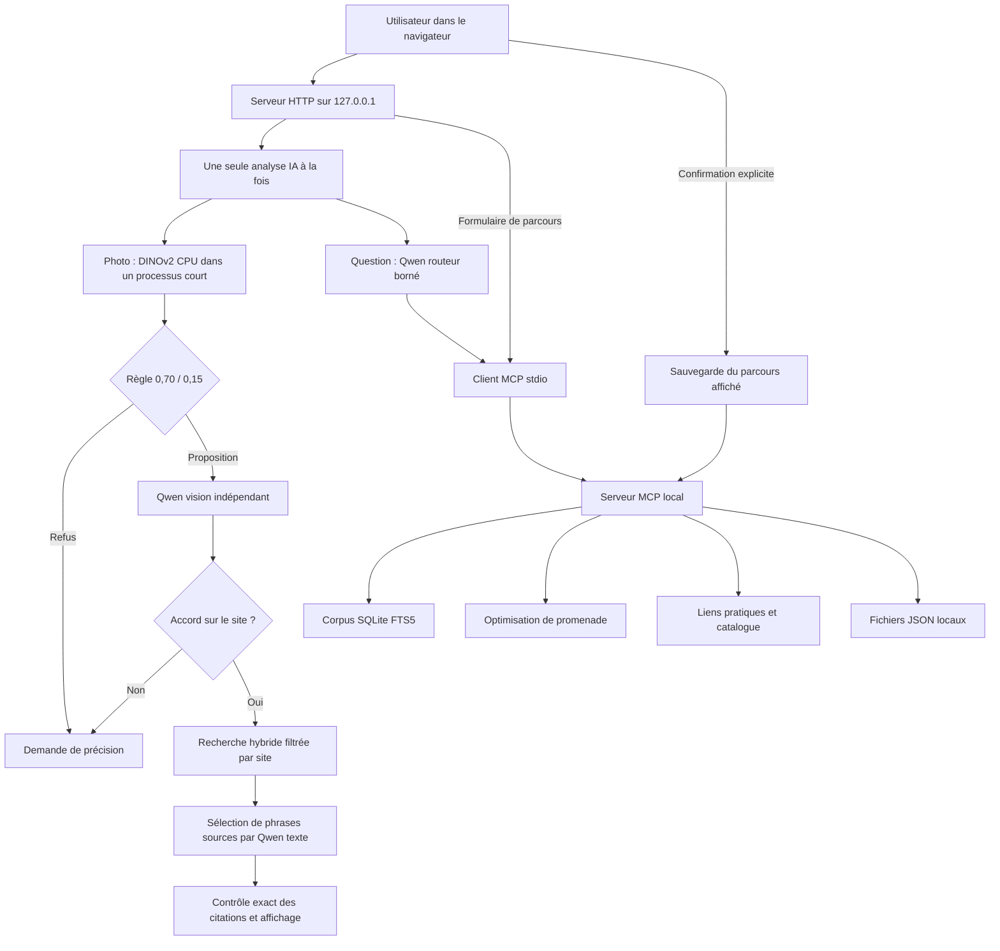

# Architecture locale

## Ressources

Le matériel cible est un PC de 16 Go de RAM avec GTX 1650 Ti de 4 Go de VRAM. DINOv2-small utilise ONNX Runtime CPU et termine son processus avant Qwen. Les modèles llama.cpp sont chargés successivement : vision, embeddings si nécessaires, génération texte. Le profil texte n'utilise pas le projecteur. Le serveur web reste léger et sérialise les analyses pour éviter deux chargements concurrents. Les outils de parcours ne chargent aucun modèle.

Le parent et le serveur web utilisent Python standard. Le composant de comparaison visuelle utilise l'environnement isolé déjà préparé avec NumPy, Pillow et ONNX Runtime. Le frontend est HTML/CSS/JavaScript sans compilation ni requête à un CDN. Il n'y a pas de dépendance à Node pour l'exécution de l'application.

## Modèles et données

| Rôle | Composant | Fonction |
|---|---|---|
| Descripteur image | DINOv2-small ONNX, CPU | Comparer la photo aux références ; score cosinus non probabiliste |
| Vision et texte | Qwen3.5-4B Q4_K_M, llama.cpp Vulkan | Proposition visuelle, choix d'action et sélection d'extraits |
| Embeddings textuels | Qwen3-Embedding-0.6B Q8_0, 1024 dimensions | Recherche dense du parcours photo |
| Recherche lexicale | SQLite FTS5 | BM25 et consultation documentaire des outils MCP |
| Fusion | RRF, avec filtre de site en amont | Combiner les classements sans mélanger les identités du catalogue |
| Parcours | Programmation dynamique sur sous-ensembles | Maximiser les étapes puis minimiser la distance estimée |

Le corpus est figé par empreintes, avec ses attributions. La banque de référence est séparée des photos de calibration et de test. Les anciens résultats restent dans les rapports privés ; les seuils de la règle ne sont pas recalculés à chaque demande.

## Réponses par citations exactes

Le mode assisté utilise `grounded_rag.py`. Une demande de présentation conserve une introduction encyclopédique du site avant les autres candidats. Les passages sont découpés en unités de citation portant un identifiant et des positions. Qwen retourne seulement les identifiants de phrases et un statut par sous-question. Le programme valide les identifiants, les positions et l'égalité avec le texte source avant d'afficher la citation.

Les présentations sont limitées aux introductions et présentations touristiques. Un passage relatant un projet concurrent ne peut donc pas servir de présentation directe du monument. Les demandes d'informations actuelles absentes du corpus sont signalées comme telles. La fidélité du texte est contrôlée ; la pertinence du choix et la vérité de la source ne sont pas déduites de cette égalité.

Les anciens lanceurs expérimentaux restent disponibles pour reproduire leurs contrats de génération historiques. La nouvelle règle documentaire concerne le parcours assisté et l'agent de l'application.

## Agent et MCP

`agent_local.py` demande à Qwen un choix structuré parmi quatre actions : `answer_heritage`, `plan_walk`, `practical_links`, `clarify`. Les identifiants sont bornés au catalogue et les paramètres numériques sont validés côté programme. L'action ne peut contenir aucune instruction d'enregistrement ou d'achat. Un contexte de lieu contradictoire provoque une clarification.

`mcp_client.py` et `mcp_server.py` communiquent en JSON-RPC sur stdio. Ils effectuent `initialize`, la notification d'initialisation et les appels d'outils. Le serveur expose des schémas d'arguments, valide les types et marque les erreurs d'outils. Il n'exécute aucune commande provenant du modèle. L'application utilise également MCP pour les parcours préparés sans IA.

## Stockage et accès

Le serveur écoute seulement sur l'interface de boucle locale. Les appels d'écriture exigent le jeton de session, une origine locale compatible et un contenu JSON. Les chemins de fichiers ne sont pas fournis par l'utilisateur : les rapports sont associés à des identifiants d'analyse et les parcours sauvegardés reçoivent un UUID. Le navigateur n'insère pas les textes du modèle comme HTML.

L'enregistrement reçoit l'identifiant d'un brouillon calculé et conservé côté serveur, puis la confirmation explicite. L'application ne se contente pas de sauvegarder n'importe quel parcours envoyé par le navigateur. Les images de travail sont supprimées après analyse ; les rapports conservent les métadonnées et décisions sans inclure l'original. À l'arrêt, seuls les processus lancés et possédés par l'application sont terminés.
